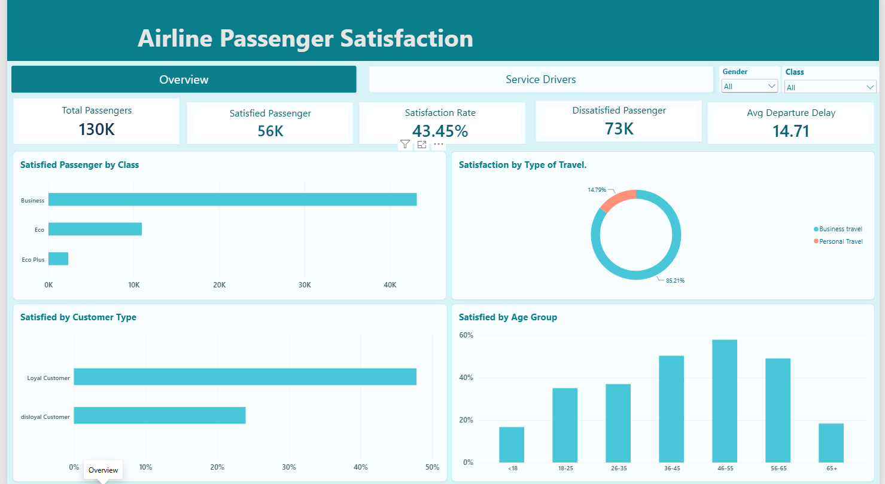
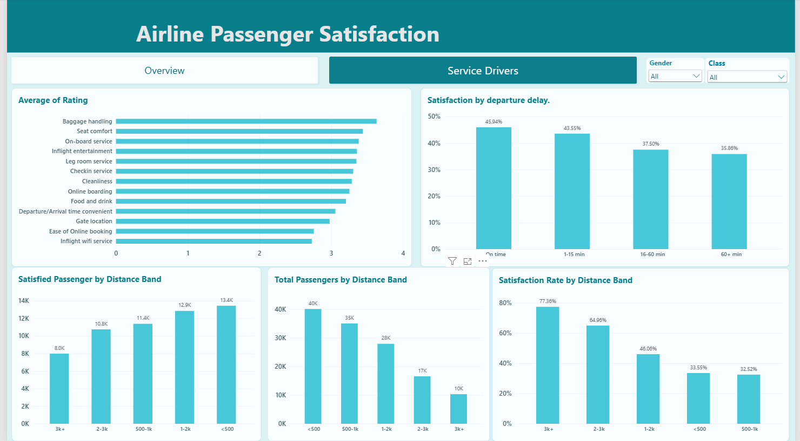

# Airline Passenger Satisfaction Analysis

## Project Overview
This project analyzes airline passenger satisfaction using Power BI. The dashboard explores passenger satisfaction patterns based on travel class, customer type, age group, flight distance, departure delays, and onboard services.

## Dashboard Preview

### 1. Overview

### 2. Service Drivers

## Key Performance Indicators (KPIs)
- Total Passengers: 130K
- Satisfied Passengers: 56K
- Satisfaction Rate: 43.45%
- Dissatisfied Passengers: 73K
- Average Departure Delay: 14.71

## Key Insights
- Business class has the highest number of satisfied passengers.
- Loyal customers show a higher satisfaction percentage than disloyal customers.
- Passengers aged 46–55 have the highest satisfaction percentage among the displayed age groups.
- Baggage handling has the highest average service rating, while inflight Wi-Fi has the lowest.
- Passenger satisfaction decreases as departure delays increase.
- The 3,000+ mile distance group has the highest satisfaction rate, but the lowest passenger volume.

## Tools & Technologies
- Power BI
- Power Query
- DAX
- Data Visualization

## Data Preparation
- Cleaned and transformed the dataset using Power Query.
- Created DAX measures for passenger count and satisfaction rate.
- Grouped flight distances into distance bands.
- Unpivoted service rating columns for service-level analysis.

To identify factors influencing airline passenger satisfaction and understand areas where airline services can be improved.

Step 4: Save your README
